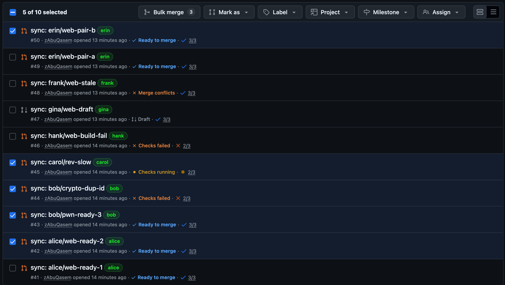
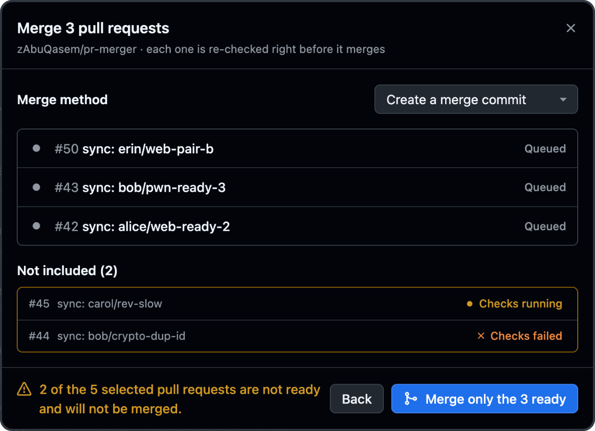
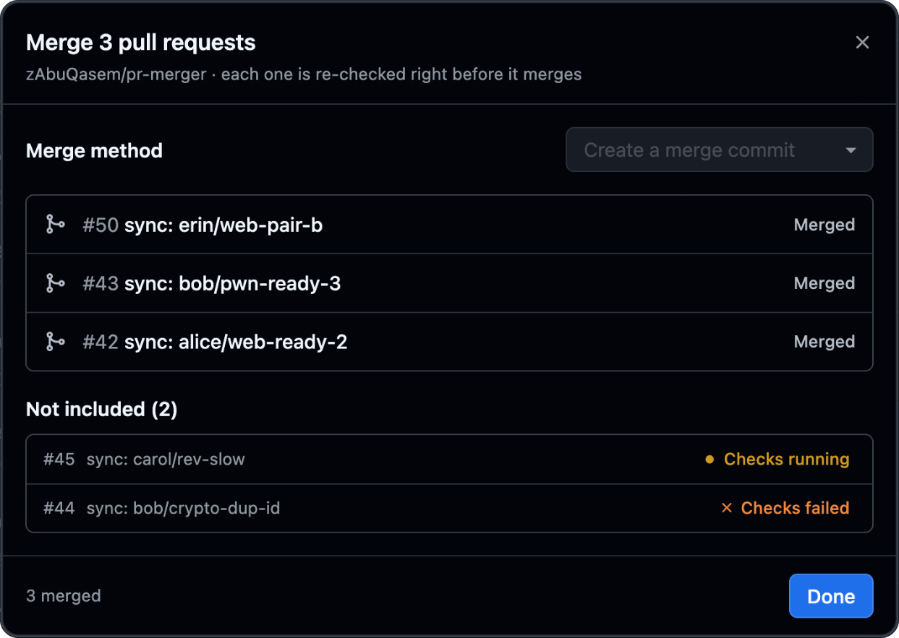
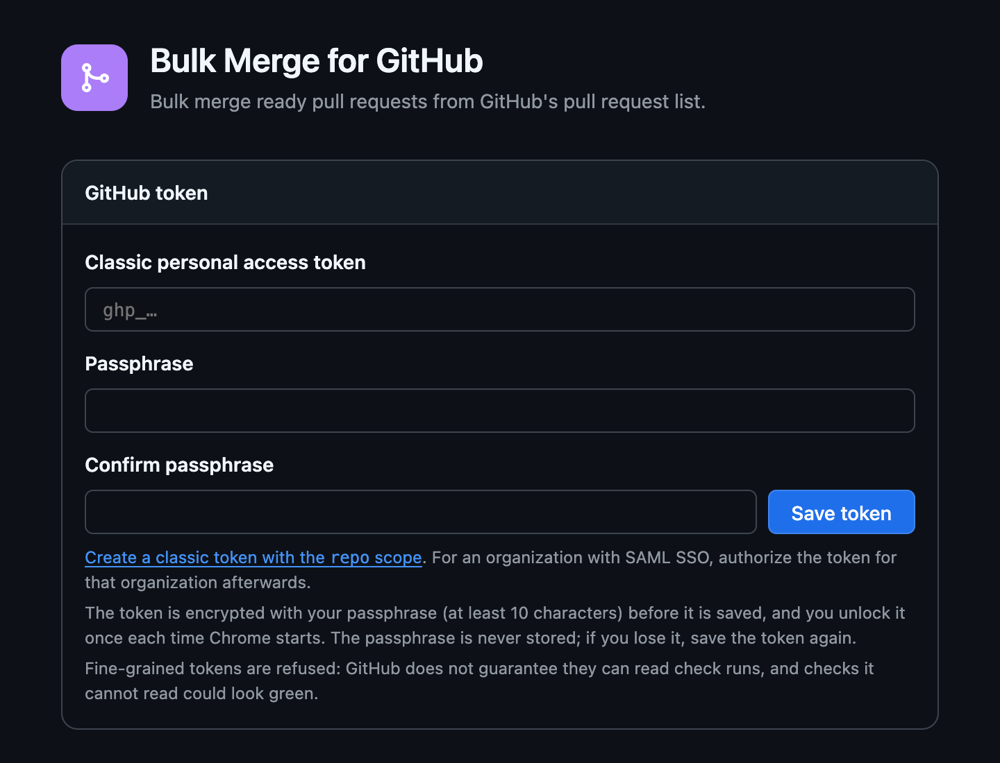

# Bulk Merge for GitHub

[](https://github.com/zAbuQasem/github-bulk-merge/actions/workflows/test.yml)
[](https://github.com/zAbuQasem/github-bulk-merge/releases/latest)
[](LICENSE)

A Chrome extension that adds a **Bulk merge** button to GitHub's pull request list. Tick as many pull requests as you like. Only the ones that are actually ready get merged.

[Why](#why) | [How it works](#how-it-works) | [Install](#install) | [Set up](#set-up) | [Security](#security) | [Development](#development) | [Author](#author) | [License](#license)



## Why

Some repositories get a lot of pull requests at once: dependency bumps, sync bots, generated content. GitHub lets you label or assign a whole selection, but merging still means opening each pull request, waiting for its checks and pressing the button.

Merging a batch blindly is worse. One red check or one conflict and you have merged something you shouldn't have. This extension does the clicking for you and refuses everything it can't confirm is safe.

## How it works

Every row shows whether it's ready, and if not, why: checks running, checks failed, merge conflicts, draft, review required, and so on. The button sits in GitHub's own selection toolbar and counts only the ready pull requests you ticked.

If your selection mixes ready and not-ready pull requests, the dialog lists what will be skipped and asks a second time before merging anything.

<p align="center">
  
  
</p>

A pull request counts as ready only when all of this holds:

- **It's open, not a draft, and has no conflicts.** GitHub itself must also report it clean to merge, so required reviews and branch rules are respected.
- **Every check on the latest commit has finished and passed.** Success, neutral and skipped pass. Running, failed, cancelled, unreadable, or no checks at all mean not ready.

When you confirm, each pull request is checked again right before its merge and merged only at the commit you saw. If someone pushed in the meantime, it's skipped. Merges go through GitHub's API with `bypass_rules: false`, so even an admin token can't skip repository rules.

Merges are sent about a second apart and finish in parallel. If one lands and makes another conflict, GitHub refuses the second one and the dialog tells you. You can stop a run at any time; merges already sent are left to finish.

## Install

You need Chrome 140 or newer.

**From a release**

1. Download `github-bulk-merge-vX.Y.Z.zip` from the [latest release](https://github.com/zAbuQasem/github-bulk-merge/releases/latest). The release notes list its SHA-256, and `SHA256SUMS` is attached if you want to check it with `sha256sum --check SHA256SUMS`.
2. Unzip it.
3. Open `chrome://extensions`, turn on **Developer mode**, choose **Load unpacked** and pick the unzipped folder.

**From source**

```bash
git clone https://github.com/zAbuQasem/github-bulk-merge.git
```

Then load the `extension/` folder the same way.

## Set up

The settings page opens on first install. You can also reach it from the extension's toolbar icon.

1. [Create a classic token with the `repo` scope](https://github.com/settings/tokens/new?scopes=repo&description=Bulk%20Merge%20for%20GitHub). If your organization uses SAML SSO, authorize the token for it afterwards.
2. Paste the token, choose a passphrase of at least 10 characters, and save.
3. Each time Chrome starts, the list shows **Locked**. Click **Unlock** and enter your passphrase.

Fine-grained tokens are refused on purpose. GitHub doesn't guarantee they can read check runs, and a check the extension can't see could look green.

<p align="center">
  
</p>

## Security

- **On disk, the token is only stored encrypted.** It's sealed with AES-256-GCM, using a key derived from your passphrase with PBKDF2-SHA256 at 600,000 rounds. The passphrase itself is never stored.
- **The unlocked token lives in memory only**, until you quit Chrome or press **Lock now**.
- **github.com never sees the token.** The script on the page only receives statuses, and every API call is made by the extension's service worker. It talks to `api.github.com` and nothing else.
- **It can't protect you from malware on your own machine** while the extension is unlocked.

Found a vulnerability? Please [report it privately](https://github.com/zAbuQasem/github-bulk-merge/security/advisories/new) rather than in a public issue.

## Development

```bash
npm ci
npx playwright install chromium
npm test
```

The unit tests cover the readiness rule, the token vault and merge outcomes. The end-to-end tests load the extension in Chromium against a fake GitHub, so they never touch the real one. CI installs packages through [Aikido Safe Chain](https://github.com/AikidoSec/safe-chain), which blocks known malware and anything published in the last 7 days.

[CONTRIBUTING.md](CONTRIBUTING.md) covers commit messages and releases.

## Author

Made by **Zeyad AbuLaban**. Find me on [LinkedIn](https://www.linkedin.com/in/zeyad-abulaban) and [GitHub](https://github.com/zAbuQasem).

If this saves you some clicks, a star on [the repository](https://github.com/zAbuQasem/github-bulk-merge) helps other people find it.

## License

[MIT](LICENSE)
